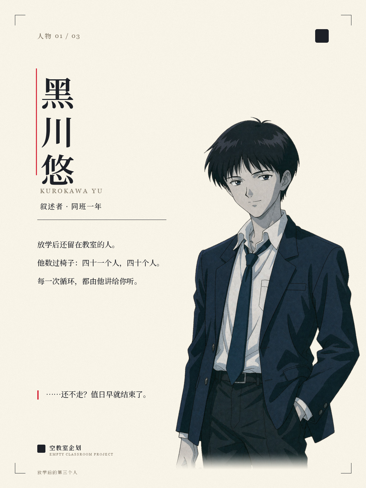
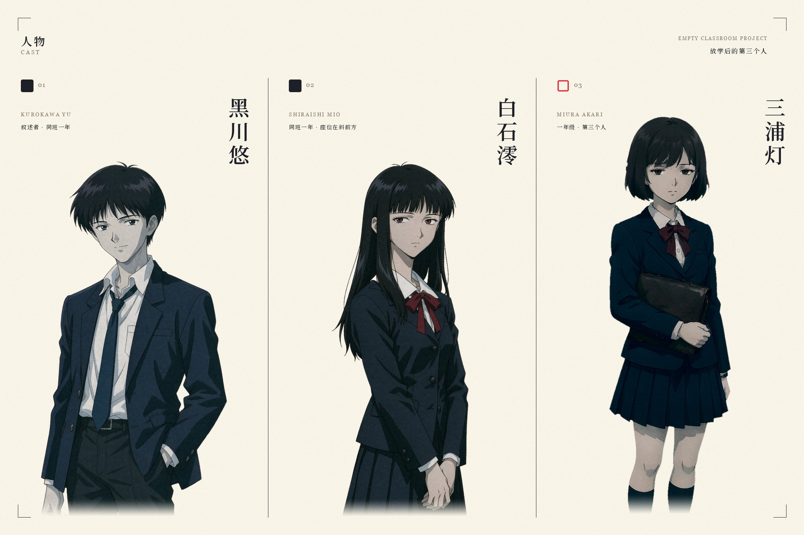

# cast-card

把一组角色排成成套的人物介绍卡：竖排姓名、立绘、身份、三行描述、原文引文，右上角一个座位标记。

单人卡 1080×1440，阵容图 2160×1440，一条命令同时输出 PNG、JPG 和一张预览页。




## 它是什么

一个 **配置驱动的排版器**。你把角色信息写进 `job.json`，它负责所有几何、字距、渐隐和配色：

```bash
python scripts/cast_card.py job.json
```

```
job.json  ──►  01_黑川悠.png   1080×1440
               02_白石澪.png
               03_三浦灯.png
               阵容图_3人.png  2160×1440
               jpg/            同名 JPG，可直接发微信
               index.html      三列网格预览页
```

**不是**通用人物卡生成器。它是**一套固定的编辑设计语言**——纸底、墨字、一处朱红、竖排姓名、人物从画布底部站上来。改配色和文案不需要动代码，改版式需要先读 `references/layout.md`。

## 为什么不用模板

因为这套版式里有一半工作在处理「素材不可控」：

| 问题 | 通用模板会怎么坏 | 这里的做法 |
|---|---|---|
| 立绘画幅比例差很大（656×1511 与 447×1734 并存） | 统一高度 → 画幅长的人矮一头 | 成员级 `scale` 单独补偿 |
| 立绘比文字栏宽 | 压住文字 | 自动按 3% 递减收窄，永不压字 |
| 素材底部是硬切的 | 一条直边 + 一圈灰雾 | 先沉底再渐隐（颜色先乘向纸色，再和 alpha 一起归零） |
| 引文横跨到人物身上 | 深墨字压在深色衣服上直接消失 | 引文宽度由立绘左缘反推 |
| 中文自动断行 | 把「明天」拆开、句号落行首 | 断点人工给 + 避头点规则 |

每条的来历和修法都写在 [`references/layout.md`](references/layout.md)。

## 安装

WorkBuddy / 支持 Agent Skills 结构的宿主，把仓库放进 skills 目录即可：

```bash
# 用户级（所有项目可用）
git clone https://github.com/<you>/cast-card.git ~/.workbuddy/skills/cast-card

# 项目级（只在当前仓库生效）
git clone https://github.com/<you>/cast-card.git .workbuddy/skills/cast-card
```

`SKILL.md` 用的是通用 Agent Skills 结构，Claude Code 等宿主也能直接读取；渲染脚本不依赖任何宿主，单独跑也行。

## 快速开始

1. 复制模板：`cp assets/job.example.json job.json`
2. 改角色、配色、立绘路径
3. 先只验单卡：`python scripts/cast_card.py job.json --no-lineup`
4. 校准后出全套：`python scripts/cast_card.py job.json`

校准只看两件事：立绘有没有压到文字栏（脚本会自动缩小，缩太多就调小 `portrait.height`）、多人并排是否一样高（给画幅更长的人加 `scale`，1.05~1.15 之间试）。

## job.json

```json
{
  "title": "作品名", "series": "人物", "project": "企划名", "project_en": "PROJECT NAME",
  "palette": { "paper": "#F9F4E8", "ink": "#1D2027", "red": "#D62C3E", "dim": "#807666" },
  "card": { "w": 1080, "h": 1440 },
  "portrait": { "height": 1100, "cx": 0.7315, "crop": 0.86,
                "fade_start": 0.90, "fade_len": 0.10, "fade_rate": 2.0 },
  "members": [
    {
      "no": "01",
      "portrait": "assets/characters/heroine_neutral.png",
      "name": "姓　名",
      "roman": "FAMILY GIVEN",
      "role": "身份 · 关系",
      "seat": "solid",
      "body": ["第一行概括。", "第二行只有这个角色会做的事。", "第三行推动剧情的事实。"],
      "quote": ["引文必须是原文，一行一条。"]
    }
  ]
}
```

| 字段 | 说明 |
|---|---|
| `card.w` / `card.h` | 排版按 `w/1080` 等比缩放，换 1200×1600 无需改代码 |
| `portrait.height` / `cx` | 立绘高度与水平中心（`cx ≤ 1` 时视为画布比例） |
| `portrait.crop` | 裁到底部留多少，默认 0.86 —— 只留到大腿，脚部交给渐隐 |
| `portrait.fade_*` | 渐隐起点、长度、沉底速率 |
| `members[].seat` | `solid` 实心座 / `hollow` 朱红空框（标记缺席者） |
| `members[].scale` | 个人立绘缩放，补偿画幅比例差 |
| `members[].quote` | **数组**，一行一条。自动断行会拆词，断点必须人工给 |
| `lineup` | 阵容图开关与尺寸 |

## 两条文案规则

模板能替你排版，替不了你写字：

- **引文必须是原文**，逐句回源文件核对。写错的引文比不写更伤。
- **描述三行不加引号**。只有引文块用「」。描述是作者视角的概括，不能伪装成台词。

## 依赖

- Python 3 + `numpy` + `Pillow`
- 中文衬线字体：优先 `NotoSerifSC-VF.ttf`（可变字重，`set_variation_by_axes` 才有粗细层次）
- 拉丁字体：Georgia

脚本内置 Windows / macOS / Linux 的字体候选表，自动 fallback；全找不到会报错并列出候选路径。若报 `ModuleNotFoundError: numpy`，换用带依赖的解释器或 `pip install numpy pillow`，不要改写脚本。

## 目录

```
SKILL.md              工作流与字段速查（宿主读取的入口）
scripts/cast_card.py  渲染器，唯一需要执行的代码
references/layout.md  几何表 + 四条踩坑记录（改版式前必读）
assets/job.example.json
docs/                 预览图
```

## 许可

MIT。示例图里的角色美术来自同人游戏项目 [《放学后的第三个人》](https://github.com/linppandtai/empty-classroom)，仅作排版效果展示；换成你自己的立绘即可。

## 相关

- [empty-classroom](https://github.com/linppandtai/empty-classroom) —— 这个 skill 就是为它做的：三张人物卡、阵容图，都是拿它的立绘排的。想看作文字冒险长什么样，去那边。
